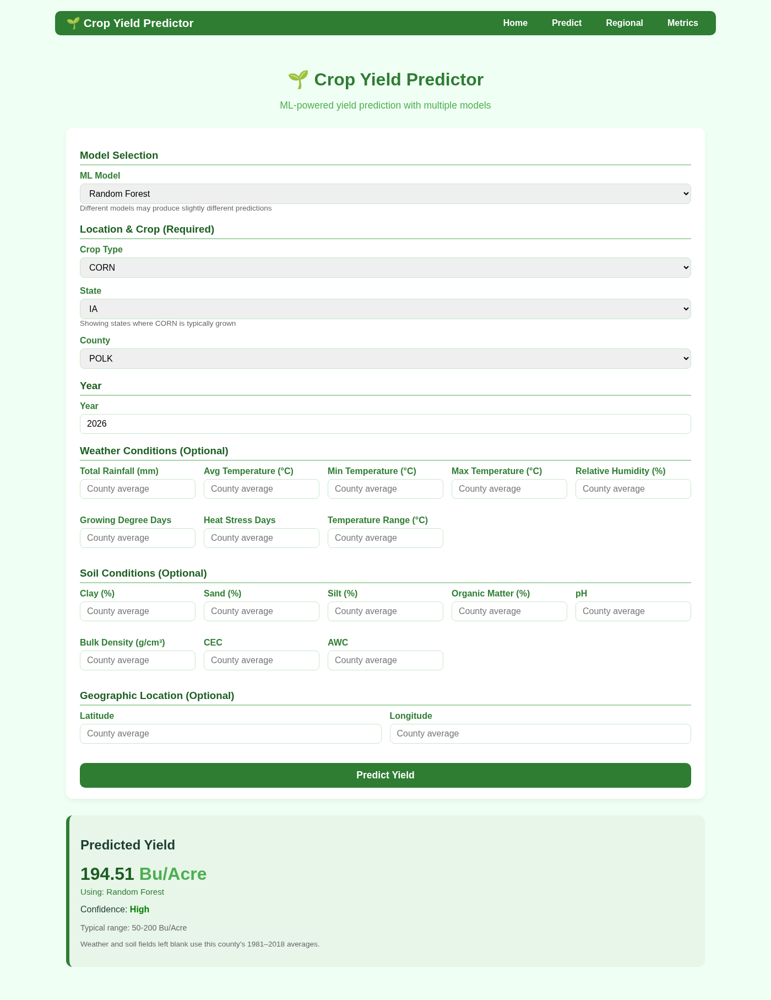
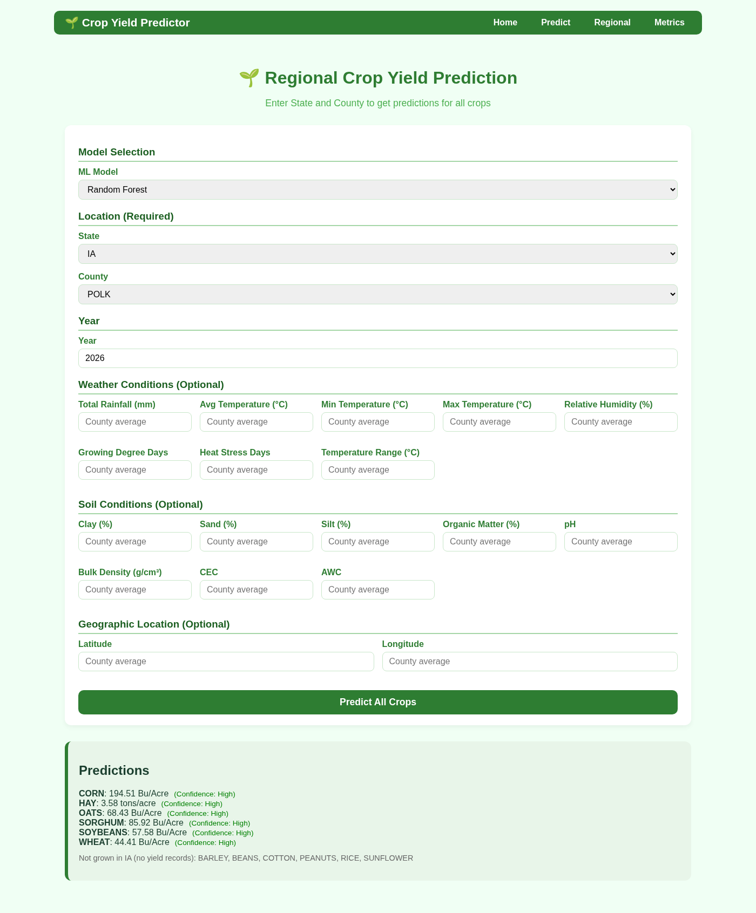
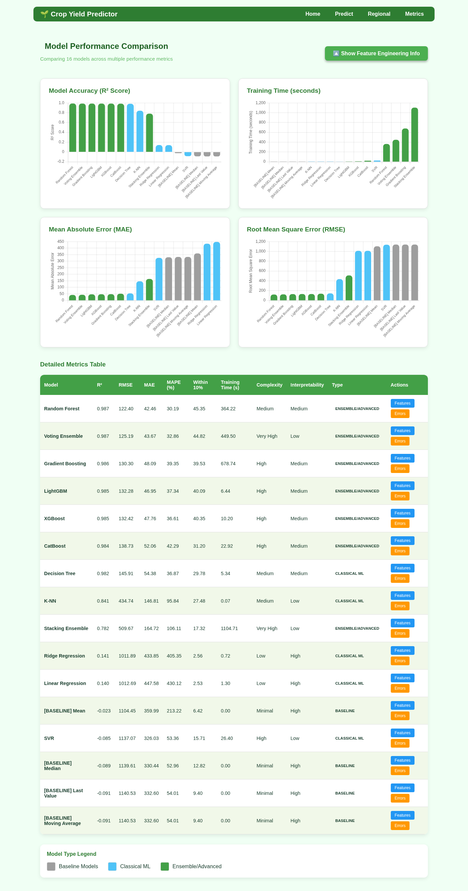
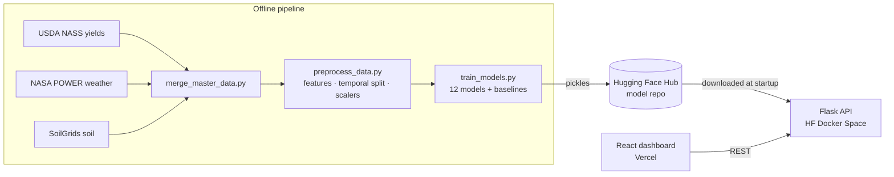

# AgroYield

**County-level crop yield prediction for the United States**, from 40+ years of USDA yield records joined with growing-season weather and soil data. It covers 12 regression models compared against naive baselines, a Flask inference API and a React dashboard.

[](https://github.com/Abdul-Wahab-17/AgroYield/actions/workflows/ci.yml)
[](LICENSE)
[](https://crop-yield-prediction-two.vercel.app)
[](https://huggingface.co/spaces/__HF_USER__/agroyield-api)



**Try it:** [crop-yield-prediction-two.vercel.app](https://crop-yield-prediction-two.vercel.app). The frontend is on Vercel and the API runs on a free Hugging Face Space, so the first request after a period of inactivity can take about a minute while the Space wakes up.

## What it does

- **Predict** the yield of one crop in one county and year, with any of the trained models. Weather, soil and location inputs are optional. Left blank, they default to **that county's 1981–2018 averages**, so a prediction reflects the county's own conditions.
- **Regional view:** predict every crop a county grows, side by side. Crops with no yield records in the state, such as peanuts in Iowa, are listed as not grown rather than extrapolated.
- **Metrics dashboard:** compare models on R², RMSE, MAE, MAPE and "within 10%". It also shows feature importance and per-model error analysis, including the largest misses.

| Regional | Metrics |
|---|---|
|  |  |

## Data

| Source | What | Rows (raw) |
|---|---|---|
| USDA NASS | County yields for 12 crops, 1981–2023 | 3.08 M |
| [NASA POWER](https://power.larc.nasa.gov/) | Daily weather per county centroid, aggregated weekly, then to growing-season features | 3.75 M |
| [ISRIC SoilGrids](https://soilgrids.org/) | Soil texture, pH, organic matter, CEC, AWC per county | 3.2 K |

`src/merge_master_data.py` joins these into **385,660 county-crop-year rows** (`data/processed/master_yield_dataset.csv`). Where the SoilGrids API failed, `download_soil_complete.py` falls back to regional estimates, so some counties' soil values are approximate.

**Features (34).** There are 19 raw weather, soil, location and year inputs and 13 engineered ones (temperature × precipitation, growing degree days per day, moisture stress, a soil quality score, a loam index, lat/long interactions and others). The remaining 2 are an extreme-heat flag and label-encoded crop, state and county. `GET /feature-engineering` documents each formula.

**Temporal split.** Train on 1981–2018, validate on 2019–2020 and test on 2021–2023, so models are always evaluated on years after the ones they learned from.

> **A caveat on the published models.** They were produced by an earlier preprocessing run whose feature scalers were fit on all years, including validation and test. Only scaling statistics leaked, never yields, but it is a leak. `src/preprocess_data.py` now fits every scaler and encoder on the training years only, so retraining with it gives a fully leakage-safe model.

## Results

These are validation-set results (2019–2020) from `models/model_comparison.csv`. Every model is also compared with four naive baselines.

| Model | R² | RMSE | MAE | MAPE | Within 10% |
|---|---:|---:|---:|---:|---:|
| **Random Forest** | **0.987** | 122.4 | 42.5 | 30.2 % | 45.4 % |
| Voting Ensemble | 0.987 | 125.2 | 43.7 | 32.9 % | 44.8 % |
| Gradient Boosting | 0.986 | 130.3 | 48.1 | 39.4 % | 39.5 % |
| LightGBM | 0.985 | 132.3 | 47.0 | 37.3 % | 40.1 % |
| XGBoost | 0.985 | 132.4 | 47.8 | 36.6 % | 40.3 % |
| CatBoost | 0.984 | 138.7 | 52.1 | 42.3 % | 31.2 % |
| Decision Tree | 0.982 | 145.9 | 54.4 | 36.9 % | 29.8 % |
| Linear Regression | 0.140 | 1012.7 | 447.6 | 430.1 % | 2.5 % |
| *Baseline: county mean* | −0.023 | 1104.4 | 360.0 | 213.2 % | 6.4 % |

On the held-out **test years (2021–2023)**, Random Forest has an MAE of 44.8 and a median absolute error of 12.3.

**Limitations**
- Tree models can't extrapolate the long-run yield trend. A county's prediction is the same for any year after 2018, so read it as "expected yield under average weather", not a forecast for that specific year.
- Blank inputs use county averages, not observed weather for the year, so a drought year won't show unless you enter its weather.

> **Reading these numbers honestly.** Yields are in each crop's own unit: bushels/acre for grains, lbs/acre for cotton, rice and peanuts, and tons/acre for hay. The scales differ by up to 1000×. R² is high largely because the models learn which crop is which. MAPE and "within 10%" are the more demanding measures, and they show there is plenty of room to improve. The worst errors come from crop failures, for example a true yield of 5.7 predicted as 143.5, which weather averages over the growing season can't capture.

## Architecture



## Run it locally

### API (no training needed)

The trained models (~280 MB) are published to the Hugging Face Hub. On first start, the API downloads them into `api/artifacts/`.

```bash
python -m venv .venv && source .venv/bin/activate
pip install -r api/requirements.txt
python api/app.py                 # http://localhost:5000
```

Or with Docker:

```bash
docker build -t agroyield-api api
docker run -p 5000:7860 agroyield-api
```

### Frontend

```bash
cd client
npm install
npm start                         # http://localhost:3000, talks to http://localhost:5000
```

To point the frontend at another API, set `REACT_APP_API_URL` (for example `REACT_APP_API_URL=https://__HF_USER__-agroyield-api.hf.space npm start`).

### Retrain from scratch

This needs about 4 GB of disk for raw data and models.

```bash
pip install -r requirements.txt
python src/download_data/download_weather_auto.py
python src/download_data/download_soil_complete.py
python src/merge_master_data.py   # needs data/raw/crop_data_pivoted.csv (USDA NASS export)
python src/preprocess_data.py
python src/model/train_models.py
python sync_models_to_api.py      # copy models + preprocessors into api/artifacts/
```

`python scripts/publish_hf.py models` and `python scripts/publish_hf.py space` republish the artifacts and the API.

## API

| Method | Endpoint | Description |
|---|---|---|
| GET | `/health` | Status, loaded models, feature count |
| GET | `/metadata` | Crops, states, available models |
| GET | `/counties/<state>` | Counties for a state code (e.g. `IA`) |
| GET | `/valid-states/<crop>` | States where a crop is grown |
| POST | `/predict` | Predict one crop/county/year |
| POST | `/predict-regional` | Predict every crop for a county |
| GET | `/metrics` | Model comparison table |
| GET | `/feature-importance/<model>` | Feature importances |
| GET | `/error-analysis/<model>` | Error distribution and largest misses |
| GET | `/feature-engineering` | Engineered feature formulas |

```bash
curl -X POST http://localhost:5000/predict \
  -H "Content-Type: application/json" \
  -d '{"Crop": "CORN", "State": "IA", "County": "POLK", "Year": 2024}'
```

Optional fields override the defaults: `model` (e.g. `"XGBoost"`), weather fields (`tavg_growing_avg`, `prcp_growing_total`, `gdd_total`, ...) and soil fields (`clay_pct`, `ph`, `organic_matter_pct`, ...).

The hosted API serves 10 of the 12 models. The Voting Ensemble (~515 MB) and K-NN (~100 MB) are left out for size, but load locally after training.

## Project structure

```text
api/          Flask API, Dockerfile, artifact downloader
client/       React dashboard (Create React App)
src/          data download, merge, preprocessing, training
models/       error analysis and feature importance outputs (models themselves are on the Hub)
scripts/      publishing to Hugging Face
```

## License

[MIT](LICENSE) © 2026 Abdul Wahab
